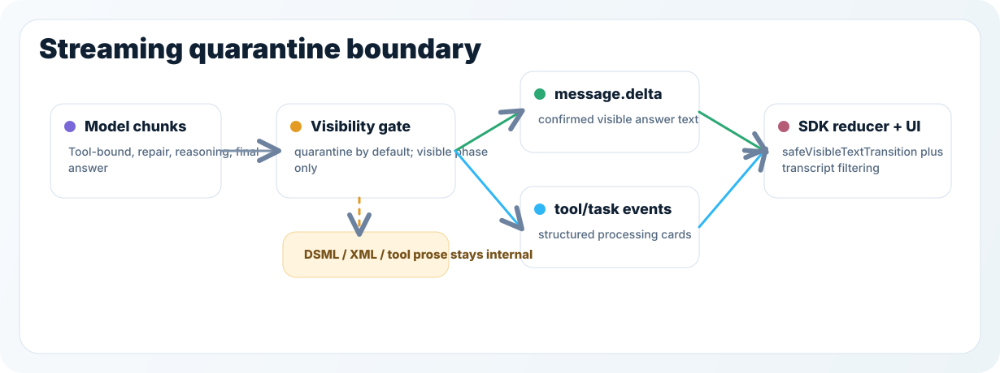

# Streaming Contract

更新时间：2026-09-28

This document is the canonical contract for Focus Agent streaming. It covers the server-side SSE event model, visible-text isolation, tool protocol quarantine, and the frontend SDK reducer boundary.



## 1. Stream Shape

Focus Agent uses authenticated POST requests that return Server-Sent Events:

```text
POST /v2/threads/{thread_id}/runs/stream
POST /v2/threads/{thread_id}/runs/resume/stream
POST /v2/runs/{run_id}/stream
```

Cancellation is JSON, not SSE:

```text
POST /v2/runs/{run_id}/cancel
POST /v2/threads/{thread_id}/runs/cancel
```

The thread-level cancel endpoint is for UI/client cleanup when the caller only
has the active thread context. It cancels active runs for that thread and is
exposed as `FocusAgentClient.cancelThreadHarnessRuns()`.

The public event names are stable. Do not introduce a new public event for internal stream visibility state.

```text
run.metadata
run.status
run.completed
run.failed
run.interrupt
run.rollback.started
run.rollback.succeeded
run.rollback.failed
run.closed
server_shutdown
heartbeat
state.update
message.delta
message.completed
reasoning.delta
tool.call.delta
tool.requested
tool.error
tool.result
task.update
```

Clients should treat `run.completed`, `run.failed`, `run.closed`,
`run.rollback.failed`, and
`server_shutdown` as terminal or reconnect-relevant turn signals. `heartbeat` is
transport liveness only. `server_shutdown` is emitted during graceful shutdown so
clients can stop reading the current stream and resume or reconnect according to
their own policy.

Pre-turn branch recommendations are **answer-first** by default. When the
recommendation is not an explicit branch command (topic drift, qualified
exploration, side question, comparison, detour, merge-back), the server stores a
pending Branch Action with `delivery="after_answer"` and then runs the normal
graph turn: the stream carries the usual `message.delta` / `message.completed`
events for the answer, and the card arrives with the turn's
`run.completed.thread_state.branch_actions`. Clients must therefore accept a new
pending Branch Action arriving together with, or after, the answer and anchor it
after the answered turn. A later user message implicitly dismisses that card
(`reason="superseded_by_next_turn"`).

Only explicit branch commands that reach the recommendation path (for example
"new branch for X") still short-circuit the stream: the server may publish
`message.completed` with `source="branch_recommendation"` and then
`run.completed` with `thread_state`, `branch_action` (`delivery="proposal"`),
and an extra `branch_decision` payload field. That path intentionally has no
`message.delta` chunks and does not invoke the normal graph turn.

When a stream executes a Branch Action (`run.completed` with `navigation`), the
optional `handoff_message` field is the message the client should auto-run in
the navigated thread. `null` means nothing should run because the new branch
already contains the answered turn (answer-first child forks); clients fall back
to `branch_action.handoff_message` only when the field is absent.

### 1.1 Outcome, End, And Cleanup

Protocol terminal events and server bridge lifetime are related but distinct:

- `run.completed` and `run.failed` describe the turn outcome. Publishing either
  event by itself does **not** mark `InMemoryStreamBridge` ended and does not
  schedule bridge cleanup.
- `run.closed` is a public lifecycle event. Publishing it marks the in-memory
  stream ended and schedules cleanup.
- `publish_end(run_id)` is an internal producer signal, not an SSE event. It
  also marks the stream ended and schedules cleanup.
- The normal `AgentEventPublisher.on_turn_completed(..., close=True)` path emits
  the outcome and then closes the publisher, which emits one `run.closed` and
  calls `publish_end()` once.

Each ended run has at most one cleanup timer. The configured
`streaming.cleanup_delay_seconds` (60 seconds by default) is a grace window:
the bounded in-memory event buffer remains available to late or reconnecting
subscribers during the window. After it expires, the run stream, its event-ID
counter, and its cleanup task are removed from the memory bridge.

`JournaledStreamBridge` persists published events separately. After in-memory
cleanup, it can still replay retained journal events from a matching
`Last-Event-ID` and terminate replay from the persisted `run.closed`/terminal
run state. Memory cleanup must therefore not be described as deletion of the
run journal. This is event/metadata replay only: it does not reattach or restart
the graph producer after a process failure.

`AgentEventPublisher.close()` is concurrency-safe: concurrent callers await one
shielded close task, so caller cancellation does not cancel the shared close
and only one `run.closed` plus one `publish_end()` is produced. Bridge
`shutdown()` cancels and awaits every delayed cleanup task, clears in-memory
run/counter state, and wakes subscribers; a clean shutdown must leave no pending
cleanup timers.

### 1.2 SDK Reconnect Contract

The Web SDK keeps the latest keyed SSE event ID and sends it as
`Last-Event-ID` when reconnecting or resuming. One event-ID set is retained for
the full logical stream, across all transport connections, so replayed keyed
events are delivered to the consumer only once. Events without an ID are not
deduplicated.

If transport EOF arrives before a terminal event, the SDK resumes a known run
within its bounded reconnect budget. If no terminal event is observed after
reconnects are exhausted, or the stream cannot be resumed, iteration throws
`FocusAgentIncompleteStreamError` rather than silently treating partial output
as success. Its optional `runId` identifies the run when the stream exposed one.
An explicit caller `AbortSignal` remains cancellation, not an incomplete-stream
failure.

Reconnect and execution resume are separate contracts. `/runs/resume/stream`
requires an explicit caller `Command(resume=...)` checkpoint payload; a persisted
run journal or an SSE `Last-Event-ID` does not itself hydrate a generic
`RunManager`, requeue a crashed run, or wake a follow-up handler.

## 2. Visible Text Boundary

`message.delta` and `message.completed` are the only events that may carry user-visible assistant answer text.

Server producers must enforce this rule:

- Model streams are `quarantine` by default.
- Only chunks explicitly marked with internal `stream_phase=visible` may become `message.delta`.
- Tool-bound model calls, repair calls, tool planning, and missing phase metadata stay quarantined. The v2 model-driven agent call is `visible` because the model decides about tools while it streams.
- Tool calls continue to publish `tool.call.delta`, tool lifecycle events, `reasoning.delta`, `task.update`, and `state.update` while visible text is quarantined.
- Visible text is buffered and filtered per model `message_id`. When a later message starts publishing, its first `message.delta` is prefixed with a blank line, so a tool preamble and the answer never run together.
- `message.completed` prefers the final graph-state assistant answer. A dirty stream buffer must not overwrite a safe final answer, and a stream buffer whose message carried tool calls is never used as the completed answer.

The internal phase can be carried as `stream_phase` / `focus_agent_stream_phase` metadata or as `stream_phase:*` / `focus_agent_stream_phase:*` tags. These fields are internal only and must be stripped from public event metadata.

## 3. Tool Protocol Isolation

Real tool calls must use the model/tool-call interface and public tool events. DSML, XML-ish function-call text, bracket tool markers, bare tool references such as `websearch` / `webfetch`, and internal process narration are not valid visible assistant text.

Filtering is intentionally layered:

- Graph repair prompts try to convert textual tool-call artifacts into structured tool calls or tool-free final answers.
- The harness stream producer gates visible text by phase and filters textual artifacts from visible, reasoning, and completed content.
- The frontend SDK reducer applies `safeVisibleTextTransition()` as a defensive layer for replayed events, older servers, and split deltas.
- Web transcript filtering still protects historical messages that were persisted before the current contract.
- Chinese tool-deliberation fragments are treated as internal process text, including split prefixes such as `我因为` and visible-looking fragments that describe retrying or directly invoking web tools.

This layered filtering is not redundant. Each layer protects a different failure mode.

## 4. Tool And Processing Events

Tool activity should be rendered from structured events, not from assistant text:

- `tool.call.delta` carries streamed call arguments in `args_delta`; optional `id` / `tool_call_id` and `name` / `tool_name` are included when known.
- `tool.requested`, `tool.result`, and `tool.error` represent tool lifecycle state. `tool.result` / `tool.error` payloads carry `runtime` and graph-authored `tool_outcome` when available. If a custom payload lacks a call id, it is downgraded to `state.update`.
- `task.update` carries process-level progress and may be shown in processing cards.
- `state.update` is for raw state/debug panels and should not be rendered as assistant answer text.

`message.completed`, `run.completed`, and `run.failed` must carry graph-authored `task_outcome` when one is available. `run.failed` should include the latest sanitized `thread_state` whenever the thread is known, so the UI can render the non-empty failure state and avoid reusing an old assistant answer. `task_outcome` is canonical; `runtime_outcome` / `runtimeOutcome` are legacy compatibility fields only, and clients must prefer `task_outcome` when both are present. Clients should render these fields as status metadata and must not infer final task success from raw tool payload shape. The canonical outcome state machine is documented in [runtime-outcomes.md](runtime-outcomes.md).

The SDK reducer derives `processingSteps` from reasoning, tool call, tool lifecycle, and task events. New UI should use `processingSteps` as the canonical processing-card input. `toolCalls`, `toolEvents`, and `reasoningText` remain available as raw/debug/backcompat state.

Tool step identity is resolved in this order:

```text
tool_call_id or id
namespace + tool name
tool name
namespace
"tool"
```

Tool lifecycle status maps as:

```text
tool.requested -> pending
tool.call.delta -> running
tool.result -> completed
tool.error -> failed
```

When a tool fails and later recovers, reducers should preserve `toolOutcomeHistory` on the processing step. The UI may summarize the final state as completed, but the failed observation remains part of the current turn audit trail.

`task.update` only accepts `pending`, `running`, `completed`, and `failed`; unknown statuses are treated as `running`.

## 5. Validation

When stream behavior, tool protocol filtering, frontend SDK reducers, or processing cards change, run:

```bash
.venv/bin/pytest \
  tests/test_streaming.py \
  tests/test_stream_bridge_cleanup.py \
  tests/test_harness_observability.py \
  tests/test_harness_api.py \
  tests/test_graph_builder.py \
  tests/test_execution_contract.py -q
pnpm test:thread-stream-frontend-regressions
pnpm sdk:check
pnpm web:check
```

If the streamed turn uses `live_web_research`, also verify relative-time
queries anchor through `current_utc_time`, evidence is relevant to the latest
user query, and stale evidence triggers at most one repair search before a
supported answer or explicit uncertainty answer.

When branch recommendation or Branch Action streaming behavior changes, include:

```bash
uv run pytest tests/test_branch_decision_service.py tests/test_branch_decision_repository.py tests/test_chat_service.py tests/test_harness_api.py
make sdk-openapi-types-check
```

For browser-level regressions, run a tool-using prompt through `make ui-smoke` or `scripts/ui_smoke_test.py` and confirm:

- no DSML/XML/function-call text appears in the assistant bubble,
- tool and task cards still appear before final text,
- final `message.completed` replaces any temporary stream buffer,
- public metadata does not expose `stream_phase`.
